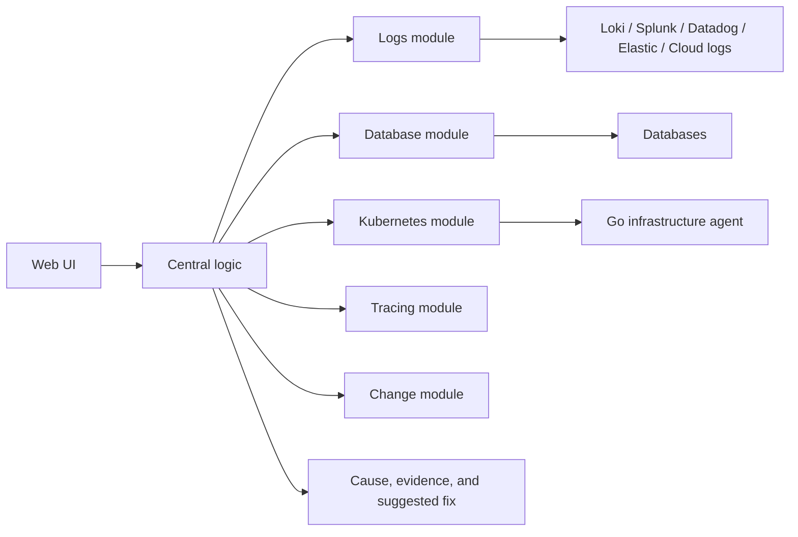
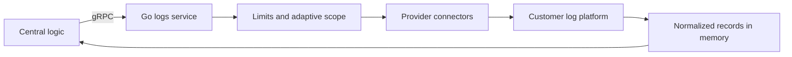

# QuellOps

An open-source system that connects to infrastructure tools, collects evidence, finds
likely causes of incidents, and helps operators decide what to fix.

## Run the logs module

```bash
git clone https://github.com/mishalraj/infra-project-poc-mishalraj.git quellops
cd quellops
./install.sh
```

The installer creates local secrets, builds the containers, starts the services, and
opens `http://127.0.0.1:8088/ui/logs.html`.

SQLite is the zero-setup default. For shared PostgreSQL storage across backend replicas:

```bash
./install.sh --postgres
```

For Kafka-compatible event streaming with the bundled Redpanda broker:

```bash
./install.sh --postgres --kafka
```

Both backends store the same encrypted connections, watcher checkpoints, schedules,
and detection summaries. PostgreSQL adds shared transactions and replica-safe job
claims for horizontally scaled deployments. Every replica must use the same
`AIDBG_MASTER_KEY`.

## Architecture



The central logic is the brain. Infrastructure modules are independent tools that
collect and normalize evidence. An optional LLM belongs only in the central logic;
modules continue to work without it.

## Modules

| Module | Responsibility | Current implementation |
| --- | --- | --- |
| Central logic | Consumes evidence, ranks causes, and persists incident results | Python / FastAPI |
| Logs | Discovers provider scopes, fetches bounded logs, detects failure patterns, and tracks API usage and estimated cost | Go / gRPC |
| Kubernetes | Watches approved cluster scope with durable delivery, per-cluster credentials, and optional Kafka transport | Go agent / Python control API |
| Tracing | Receives OTLP traces and builds service relationships | Python |
| Database | Collects database health and slow-query evidence | Initial PostgreSQL support |
| Changes | Records deployments, code pushes, migrations, and configuration changes | Python |
| Web UI | Shows incidents and configures log sources and watchers | Static dashboard |
| Demo | Provides a small service mesh for testing incidents | Python services / Kubernetes |

## Logs module



The customer's log platform remains the source of truth. The module holds fetched
records in bounded memory and returns them to the central logic. Detection summaries
and watcher checkpoints are stored in the configured SQLite or PostgreSQL control
database so monitoring survives restarts. Raw logs are not permanently copied. The
logs module has no LLM.

Supported connectors include Loki, Splunk, Elasticsearch, OpenSearch, Graylog,
Datadog, CloudWatch Logs, Google Cloud Logging, and Azure Log Analytics.

Detailed logs configuration: [docs/LOG_CONNECTORS.md](docs/LOG_CONNECTORS.md)

Live connector validation: [docs/LOG_CONNECTOR_VALIDATION.md](docs/LOG_CONNECTOR_VALIDATION.md)

## Kubernetes module

Each cluster runs a read-only Go agent that connects outward to QuellOps. The Helm
`watchNamespaces` allowlist limits what the Kubernetes API lets it read. The portal
then chooses which of those namespaces may send evidence. Events and cluster state use the same
SQLite or PostgreSQL control storage as the logs module.

Existing `AIDBG_*` configuration names remain supported for compatibility.

Operational APIs require `AIDBG_ADMIN_API_TOKEN`. Direct change ingestion uses the
separate `AIDBG_CHANGE_INGEST_TOKEN`, and GitHub webhooks require an
`X-Hub-Signature-256` generated with `AIDBG_GITHUB_WEBHOOK_SECRET`. The logs gRPC
connection supports TLS through `AIDBG_LOG_TLS_CERT`, `AIDBG_LOG_TLS_KEY`, and
`AIDBG_LOG_TLS_CA`; otherwise keep it on a private container or cluster network.

Kubernetes setup: [docs/KUBERNETES_MODULE.md](docs/KUBERNETES_MODULE.md)

Production Helm chart: [charts/quellops-agent](charts/quellops-agent)

Kafka transport: [docs/KAFKA_TRANSPORT.md](docs/KAFKA_TRANSPORT.md)

Engineering overview: [docs/ENGINEERING_OVERVIEW.md](docs/ENGINEERING_OVERVIEW.md)
