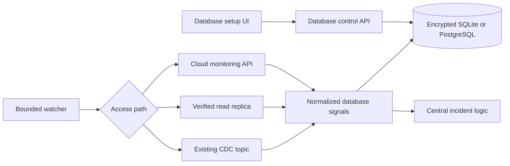

# Database module

The database module collects health evidence without changing customer data. It has
no LLM and never connects directly to a writable primary.

## Access paths

| Path | Use | Safety boundary |
| --- | --- | --- |
| Cloud metrics | AWS, GCP, Azure, and OCI managed services | Calls monitoring APIs; never opens a database connection |
| Read replica | PostgreSQL, MySQL/MariaDB, SQL Server, Oracle, MongoDB, and Redis | Verifies replica role and read-only credentials before collecting bounded health data |
| CDC | Existing Kafka-compatible Debezium or provider change stream | Reads bounded event samples and never commits offsets |

Managed SQL, NoSQL, cache, search, and warehouse services appear in the UI catalog.
Provider metrics are normalized into the same signal format, so the central logic does
not need provider-specific code.

## Flow

SQLite is the local default. Set `AIDBG_CONTROL_DATABASE_URL` to share state and job
leases across production replicas. Credentials are AES-GCM encrypted with
`AIDBG_MASTER_KEY`, and API operations require `AIDBG_ADMIN_API_TOKEN`.

The watcher limits each cycle by time, requests, returned rows, and connection count.
Failures use exponential backoff. Provider request counts and estimated cost are kept
with watcher status.

Open `http://127.0.0.1:8088/ui/databases.html` after installation.
