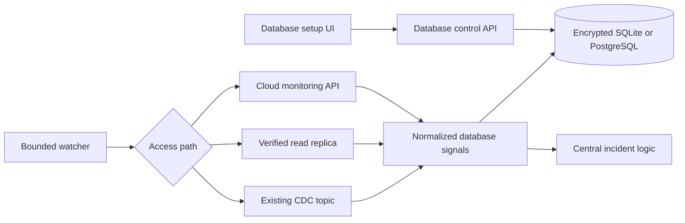

# Database module

The database module collects health evidence without changing customer data. It has
no LLM and never connects directly to a writable primary.

## Access paths

| Path | Use | Safety boundary |
| --- | --- | --- |
| Cloud metrics | AWS, GCP, Azure, and OCI managed services | Calls monitoring APIs; never opens a database connection |
| Read replica | PostgreSQL, MySQL/MariaDB, SQL Server, Oracle, MongoDB, and Redis | Verifies replica role and read-only credentials before collecting bounded health data |
| CDC | Existing Kafka-compatible Debezium or provider change stream | Reads bounded event samples and never commits offsets |

Managed SQL, NoSQL, cache, search, and warehouse services appear in the UI catalog.
Provider metrics are normalized into the same signal format, so the central logic does
not need provider-specific code.

Cloud setup first uses the provider inventory API to discover matching databases. The
operator selects an allowed resource from that list; resource IDs do not need to be
copied manually. Discovery supports RDS, Aurora, DynamoDB, DocumentDB, ElastiCache,
Redshift, Cloud SQL, AlloyDB, Spanner, Firestore, Memorystore, Azure database services,
Cosmos DB, Azure Cache, and OCI database services.

## Flow



SQLite is the local default. Set `AIDBG_CONTROL_DATABASE_URL` to share state and job
leases across production replicas. Credentials are AES-GCM encrypted with
`AIDBG_MASTER_KEY`, and API operations require `AIDBG_ADMIN_API_TOKEN`.

The watcher limits each cycle by time, requests, returned rows, and connection count.
Failures use exponential backoff. Provider request counts and estimated cost are kept
with watcher status.

Every collection emits a `connection_health` signal. The central incident output keeps
bounded `database_evidence` beside log and Kubernetes evidence, and ranks critical
database metrics, historical anomalies, and connection failures against the affected
service.

Rotate credentials through
`POST /admin/databases/sources/{name}/credentials/rotate`. QuellOps verifies the complete
replacement set before an atomic encrypted update. Failed verification leaves the active
credentials unchanged. Public responses expose only credential keys, version, and
rotation time.

After ten samples of the same metric, the watcher learns a robust median and median
absolute deviation baseline. A large change is recorded as warning or critical evidence
with the baseline, score, relative change, and sample count. The dashboard plots recent
history against that baseline and marks detected anomalies.

## Verified local integrations

| Capability | Automated validation | Status |
| --- | --- | --- |
| MySQL 8.4 read replica | GTID replication; writable primary rejected | Verified |
| MongoDB 8 replica set | Elected primary rejected; discovered secondary accepted | Verified |
| Redis 7 replica | Primary rejected; read-only replica accepted | Verified |
| Debezium MySQL CDC | MySQL to Debezium to Redpanda to QuellOps | Verified |
| PostgreSQL control store | 12 sources, four workers, worker restart | Verified |
| PostgreSQL 17 physical standby | `pg_basebackup` streaming replica; primary rejected; read-only monitor accepted on standby | Verified |
| Oracle Data Guard | Requires an external Oracle environment | Not live-validated |
| SQL Server Always On | Requires an external SQL Server environment | Not live-validated |

Run the real local connectors with:

```bash
./scripts/test_database_integrations.sh
```

The integration environment creates a real PostgreSQL physical streaming standby,
then verifies that the connector refuses the primary and collects only from the
read-only replica. It also exercises MySQL, MongoDB, Redis, and a Debezium CDC event.

Database warnings join logs, Kubernetes events, changes, and trace anomalies in the
central incident timeline. Each timeline item identifies its service and explains
whether it was linked by the incident time window, a matching trace service, or a
matching ranked cause.

The script runs replica and CDC phases separately for developer-laptop memory limits,
then removes its containers and volumes. It does not use provider mocks.

Run the three-minute shared-store load and restart test with:

```bash
./scripts/test_database_soak.sh
```

Override its duration and source count with `DATABASE_SOAK_SECONDS` and
`DATABASE_SOAK_SOURCES`.

Open `http://127.0.0.1:8088/ui/databases.html` after installation.
