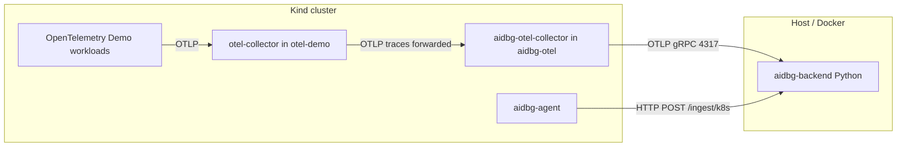

# Engineering overview: AI production debugger (local MVP)

This document describes **what the product is**, **which signals we ingest**, **how we simulate incidents**, and **how cause ranking works**—for demos and onboarding.

---

## 1. Product intent

**Goal:** A **local-first MVP** for an “AI production debugger”: correlate **distributed traces** with **Kubernetes change and health signals**, surface **anomalies** and a **ranked incident hypothesis**, and optionally add a **natural-language explanation** (Azure OpenAI) on top.

**Non-goals (today):** Production-grade auth, multi-cluster federation, long-term trace storage, or ML-based ranking. The ranker is **deterministic and heuristic** so scenarios and CI can assert behavior.

---

## 2. High-level architecture

**Components (repo):**

| Area | Role |
|------|------|
| `agent/` | Go in-cluster watcher: Deployments, Pods, Events → JSON → `POST /ingest/k8s` |
| `backend/` | FastAPI: OTLP gRPC ingest, in-memory graph + anomaly + incident APIs |
| `deploy/` | Helm values, OTel demo “light” profile, `aidbg` collector + agent manifests |
| `scripts/` | Bootstrap, deploy, load generation, scenario runners |
| `scenarios/` | Declarative incident simulations + assertions |

---

## 3. How we read signals

### 3.1 Distributed traces (OTLP)

- Demo services emit OTLP to the **in-namespace** `otel-collector` (Helm subchart).
- Helm values (`deploy/otel-demo/values-light.yaml`) add an exporter so traces are also sent to **`aidbg-otel-collector.aidbg-otel`** (cluster DNS).
- `aidbg-otel-collector` forwards OTLP **gRPC** to the **backend** on the host (Docker-published `4317` by default; Linux may need the correct bridge IP in `AIDBG_BACKEND_OTLP_ENDPOINT`).

**Backend processing** (`backend/src/aidbg/ingest_otlp.py`):

- Implements OTLP **trace** gRPC `Export`.
- For each batch: extracts `service.name`, span latency, errors, parent links.
- Builds **service-to-service edges** when parent/child spans map to different services.
- Stores recent span points and edges in memory (time-trimmed).

**Useful APIs:** `GET /stats/ingest`, `GET /stats/services`, `GET /graph/snapshot`.

### 3.2 Kubernetes signals

- **`aidbg-agent`** uses shared informers (Deployments, Pods, Events) and maps cluster changes to a small JSON schema (`agent/main.go`).
- Each signal is sent to **`POST /ingest/k8s`** on the backend.
- Backend wraps payloads as `K8sSignal` and appends to an in-memory deque (`backend/src/aidbg/api.py`, `engine.py`).

These events power **deploy / scale / crashloop-style** cause candidates in the incident builder.

### 3.3 Anomalies (derived from traces, not raw OTLP)

`SignalStore.detect_anomalies()` (`backend/src/aidbg/engine.py`):

- Splits span history into **current window** vs **baseline window** (configurable, default from settings).
- Per **service**: requires minimum span counts in both windows.
- Flags:
  - **Latency spike:** current p95 / baseline p95 ≥ **1.5**
  - **Error spike:** current error rate − baseline error rate ≥ **0.05**

**API:** `GET /anomalies/latest`

---

## 4. How we simulate flows (scenarios)

We use the **OpenTelemetry Demo** as a realistic microservice graph plus **scripted fault injection**.

### 4.1 Environment bootstrap

1. **`scripts/bootstrap_local.sh`**  
   Kind cluster, OTel demo (light profile), `aidbg` collector, agent image build/load, agent deploy.

2. **Backend**  
   `BACKEND_MODE=docker scripts/backend_up.sh` (or venv mode) starts the Python process with OTLP + HTTP API.

3. **Optional load**  
   `scripts/run_load.sh` hits the demo via `kubectl port-forward` to `frontend-proxy:8080` (or equivalent local URL).

### 4.2 Scenario specs (`scenarios/*.yaml`)

Each scenario defines:

- **target:** `namespace` + `deployment`
- **inject:** how to fault the system (`rollout_restart`, `annotate_placeholder` + rollout, `scale_to_zero`, `load_spike_only`)
- **assert:** expected cause types in top‑k, or `not_top_1_type`, plus optional `wait_seconds`

**Runner:** `scripts/run_scenario.sh`  
- Performs `kubectl` injection, waits, curls backend endpoints, writes **`artifacts/<scenario>/`**, validates `incident.json`.

**Suite:** `scripts/run_all_scenarios.sh`  
- Validates scenario YAML, optional baseline load, runs scenarios in an order that avoids cross-test contamination, restores `cart` replicas on exit.

### 4.3 Scenario catalog (intent)

| Scenario | Injection idea | What we exercise |
|----------|----------------|------------------|
| `deploy_latency` | Rollout restart `frontend` | Deploy noise + latency under rollout |
| `db_slowdown` | Annotate + restart `product-catalog` | “Change” style signal without a real DB fault (placeholder) |
| `traffic_spike_false_positive` | No k8s fault; extra HTTP load | High trace volume without deploy as top cause |
| `dependency_down` | Scale `cart` to 0 | Clear dependency / availability signal |

---

## 5. How ranking works (incident assembly)

**Endpoint:** `GET /incident/latest` builds a JSON incident from `SignalStore.build_incident()` (`backend/src/aidbg/engine.py`).

**Outputs include:**

- `anomalies` — from trace comparison (Section 3.3)
- `top_causes` — **up to 3** ranked candidate causes
- `confidence` — simple function of anomaly/candidate counts (cap 0.95)
- `graph_snapshot` — nodes/edges with counts and p95 latency on edges

### 5.1 Candidate buckets (not ML)

All candidates are **heuristic** and carry a numeric **`score`**. They are concatenated, **sorted by `score` descending**, and the top three become `top_causes`.

1. **`recent_deploy`**  
   - Scans recent K8s events whose `type` contains `"deployment"`.  
   - Time-decayed score (newer → higher).  
   - **Bonus** if deployment name matches an anomaly entity.

2. **`dependency_unavailable`**  
   - **Scale-to-zero style:** `desired_replicas == "0"` in event fields → stronger score band.  
   - **Pod trouble:** message/reason hints (e.g. back-off, crashloop, unhealthy) → another score band.

3. **`traffic_spike`**  
   - From per-service metrics in the **current** trace window.  
   - Service must exceed a **minimum request count** (span-derived) and have **low error rate**.  
   - **Score scales up with volume** so sustained load can outrank stale rollout noise when we intentionally load the system (important for `traffic_spike_false_positive`).

4. **`unknown_regression` (fallback)**  
   - If there are **anomalies** but **no** candidates matched, a single low-score placeholder is added so the incident shape stays valid and deterministic.

### 5.2 LLM layer (`/explain/latest`)

- **Does not replace** the heuristic ranker for `top_causes` in `incident/latest`.
- If Azure OpenAI env vars are set, the LLM receives the incident JSON and returns narrative JSON (summary, bullets, etc.).
- If not configured, returns a **deterministic fallback** payload (`backend/src/aidbg/explain_llm.py`).

**Recommendation for product direction:** keep **ranking deterministic**; use the LLM to **explain** evidence the backend already computed.

---

## 6. Observability of the pipeline

- **Ingest health:** `GET /stats/ingest` (OTLP batches) vs `POST /ingest/k8s` volume (see backend logs / agent).  
- **Collector:** `kubectl -n aidbg-otel logs deploy/aidbg-otel-collector`  
- **Scenario artifacts:** `artifacts/<scenario>/incident.json`, `graph_snapshot.json`, `anomalies.json`, `llm_answer.json`  
- **Schemas:** `backend/schemas/` for stable JSON shapes

---

## 7. Quick demo checklist (for engineering audience)

1. `scripts/bootstrap_local.sh`  
2. `BACKEND_MODE=docker scripts/backend_up.sh` (separate terminal)  
3. **GUI:** open **http://localhost:8088/ui/** — auto-refreshes ingest stats, **top causes**, **anomalies**, explain summary, and raw incident JSON (good for screen-share while you inject faults).  
4. Port-forward demo shop if using `run_load.sh`: `kubectl -n otel-demo port-forward svc/frontend-proxy 8080:8080`  
5. Optional **trace UI:** enable Jaeger (or Grafana) in a heavier Helm values overlay and use the demo’s `frontend-proxy` paths (`/jaeger/ui/`, `/grafana/`) — the default `values-light` keeps those off to save RAM on small Kind clusters.  
6. Run `scripts/run_scenario.sh dependency_down` and watch the dashboard update; artifacts still land under `artifacts/<scenario>/`.  
7. Run `scripts/run_all_scenarios.sh` for end-to-end validation  

---

## 8. Limitations (honest MVP boundaries)

- In-memory stores only; restarting the backend clears state.  
- Ranking is **rule-based**; overlapping incidents (rollout + load + stale events) can still produce debatable top causes—scenarios encode what we currently consider “good enough” for regression testing.  
- Light OTel demo profile disables some components (e.g. Kafka in original values); chart values must stay consistent with workload dependencies.

---

*Document version: aligned with repo layout and `engine.py` incident builder behavior. Update this file when ranking rules or scenario contracts change.*
