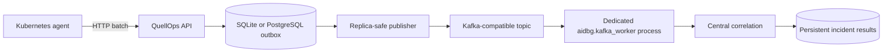

# Kafka transport

QuellOps supports Kafka-compatible brokers for production event streaming. The default
database mode remains suitable for a single machine.

## Start locally

```bash
./install.sh --postgres --kafka
```

This starts Redpanda, which implements the Kafka protocol without requiring ZooKeeper.
Use an existing Kafka or Redpanda cluster by setting:

```bash
AIDBG_EVENT_TRANSPORT=kafka
AIDBG_KAFKA_BOOTSTRAP_SERVERS=kafka-1:9092,kafka-2:9092
AIDBG_KAFKA_K8S_TOPIC=quellops.kubernetes.events.v1
AIDBG_KAFKA_CONSUMER_GROUP=quellops-central-v1
AIDBG_KAFKA_CONSUMER_EMBEDDED=false
```

For a secured cluster, configure only the settings required by the provider:

```bash
AIDBG_KAFKA_SECURITY_PROTOCOL=SASL_SSL
AIDBG_KAFKA_SASL_MECHANISM=SCRAM-SHA-512
AIDBG_KAFKA_SASL_USERNAME=quellops
AIDBG_KAFKA_SASL_PASSWORD=replace-me
AIDBG_KAFKA_SSL_CA_LOCATION=/path/to/provider-ca.pem
```

`PLAIN`, `SCRAM-SHA-256`, and `SCRAM-SHA-512` use the Kafka client's standard
mechanisms. Secrets remain environment variables and are never returned by the status
API.

## Delivery flow



The API and consumer are separate processes in the Docker stack. The API acknowledges
a batch after the database transaction succeeds. Publishers lease
outbox rows so multiple backend replicas do not intentionally publish the same event.
Kafka delivery is at least once. The dedicated consumer uses manual offset commits and
commits only after correlation and incident persistence succeed. On failure it rewinds
the partition to the failed offset, so a later commit cannot skip the event. Event IDs
remain stable across retries.

Every message contains `schema_version`, `outbox_id`, `cluster_id`, `event_id`, and the
normalized Kubernetes `event`. In Kafka mode the database bridge does not feed central
correlation; `python -m aidbg.kafka_worker` is the processing path. Events use the
cluster ID as their Kafka key, preserving each cluster's order on one partition.
QuellOps retries broker failures and
exposes publisher backlog plus consumer group, offset, lag, processed count, failures,
and last error in the Kubernetes status endpoint.

The worker writes a heartbeat and consumer status to the shared control database. This
lets any API replica report worker health without owning a Kafka consumer. Multiple
worker replicas may use the same consumer group; Kafka assigns each partition to one
worker.

Actionable incident snapshots are stored in the same SQLite or PostgreSQL control
database; normal events still advance the Kafka offset without creating empty history
rows. The latest API falls back to the stored result after a restart, and administrators
can read bounded history from `GET /admin/incidents/history`. Set
`AIDBG_INCIDENT_RETENTION` to control the number of saved snapshots (default `500`).
