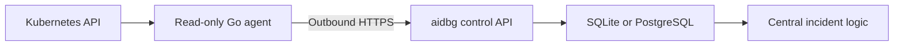

# Kubernetes module

The Go agent runs inside each Kubernetes cluster and makes outbound HTTPS requests to
aidbg. The backend never stores kubeconfig files and does not need inbound access to a
cluster.

## Install

Start aidbg first, then run:

```bash
./scripts/install_k8s_agent.sh \
  --backend-url https://aidbg.example.com \
  --cluster production
```

For local Docker Desktop Kubernetes, the default backend URL is
`http://host.docker.internal:8088`.

Open `http://127.0.0.1:8088/ui/kubernetes.html`. The agent registers the cluster and
discovers namespaces and workloads. Monitoring is off until an administrator selects
the allowed namespaces.

## Data flow



The agent watches deployment state, pod health, Kubernetes warning events, and HPA
changes. It sends normalized metadata only. It does not read Secret or ConfigMap
objects, collect container logs, execute commands, or modify cluster resources.

Events wait in a bounded in-memory queue when aidbg is unavailable. Delivery retries
with backoff and event IDs make retries idempotent. The backend enforces the selected
namespace scope again and retains the newest 5,000 events per cluster.

The default RBAC role permits read-only discovery and watches for namespaces, pods,
events, deployments, StatefulSets, DaemonSets, and HPAs. Production installations
should expose the backend over HTTPS and restrict network access to the agent endpoint.
