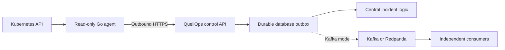

# Kubernetes module

The Go agent runs inside each Kubernetes cluster and makes outbound HTTPS requests to
QuellOps. The backend never stores kubeconfig files and does not need inbound access to a
cluster.

## Install

Start QuellOps first, then run:

```bash
./scripts/install_k8s_agent.sh \
  --backend-url https://quellops.example.com \
  --cluster production
```

For local Docker Desktop Kubernetes, the default backend URL is
`http://host.docker.internal:8088`.

Open `http://127.0.0.1:8088/ui/kubernetes.html`. The agent registers the cluster and
discovers namespaces and workloads. Monitoring is off until an administrator selects
the allowed namespaces.

For production installation and upgrades, use the Helm chart:

```bash
helm upgrade --install quellops-agent ./charts/quellops-agent \
  --namespace quellops-system --create-namespace \
  --set controlPlaneURL=https://quellops.example.com \
  --set clusterID=production \
  --set 'watchNamespaces={production,checkout}' \
  --set credentials.bootstrapToken="$QUELLOPS_BOOTSTRAP_TOKEN"
```

## Data flow



The default chart creates a Role and RoleBinding in each `watchNamespaces` entry, so
the agent cannot read anything outside that installation allowlist. The portal chooses
a subset of that allowlist for event delivery. Use `watchNamespaces={*}` only when an
administrator explicitly accepts cluster-wide read access; this mode also enables node
pressure monitoring.

Within its allowed scope, the agent watches Pods, Events, Deployments, StatefulSets, DaemonSets, HPAs,
Jobs, CronJobs, PVCs, and Ingresses. It detects workload degradation, failed jobs,
scheduling pressure, storage failures, and missing ingress addresses. Cluster-wide
mode additionally watches Nodes. It
sends normalized metadata only. It does not read Secret or ConfigMap objects, collect
container logs, execute commands, or modify cluster resources.

Events wait in a bounded queue persisted at `/var/lib/quellops-agent/events.json` when
QuellOps is unavailable. The manifest and Helm chart mount a persistent volume there,
so restarts do not lose unsent events. Delivery retries with backoff and event IDs make
retries idempotent. The backend enforces the selected namespace scope again.

The bootstrap token is used only to enroll a cluster. Registration returns a unique
cluster token, which the agent stores on its persistent volume. Rotate it with
`POST /admin/kubernetes/clusters/{cluster_id}/rotate-token`; the old token can remain
valid for a configurable grace period during a rolling update.

The backend always commits accepted events to SQLite or PostgreSQL before acknowledging
the agent. In Kafka mode, a replica-safe outbox publisher streams those stored events to
`quellops.kubernetes.events.v1`. Broker failures leave events in the database backlog for
automatic retry, so an accepted event is not lost when Kafka is unavailable.

Set `AIDBG_K8S_RETENTION_EVENTS` to choose the number of transported events retained
per cluster (default `5000`, range `100` to `1000000`). Unsent events are never removed
by retention cleanup.

The default RBAC Roles permit read-only discovery only in configured namespaces and
watch only the resource kinds listed above. Production installations should expose the backend over HTTPS and
restrict network access to the agent endpoint.
